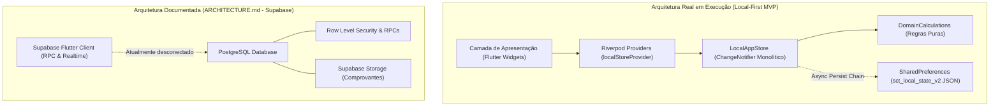

# Relatório Geral de Auditoria Técnica e Diagnóstico de Desenvolvimento — SCT (Sistema Logístico SCT)

**Data da Auditoria:** 09 de novembro de 2026  
**Responsável:** Engenharia de Software Sênior & Arquitetura de Sistemas  
**Status da Auditoria:** Concluída com sucesso — Documentação técnica estrita (sem alterações de código)  
**Branch Auditada:** `teste-cursor`  
**Commit de Referência:** `4d5aa7f` (*Alterações no checkin e recebimento de passagens*)

---

## 1. Resumo Executivo

O **Sistema Logístico SCT** é uma aplicação voltada para o planejamento, organização, alocação de transporte, cobrança financeira e check-in de congregações em assembleias e congressos.

### Estado Operacional Real
O projeto encontra-se atualmente configurado e em execução como um **MVP Local-First (Single-Device Operational Client)**. Diferente do que descreve o documento de arquitetura histórico (`ARCHITECTURE.md`), o aplicativo em execução **não** se conecta ao backend Supabase/PostgreSQL. Toda a infraestrutura operacional funciona em memória através da classe [`LocalAppStore`](file:///c:/Users/gabri/OneDrive/Área de Trabalho/PROJETO SCT/Sistema-Log-stico-SCT/lib/data/local_app_store.dart), gerenciada por Riverpod (`ChangeNotifierProvider`) e persistida como um documento JSON completo em `SharedPreferences` (`sct_local_state_v2`).

### Principais Destaques Positivos
- **Suíte de Testes Automatizados Íntegra:** 49 testes executados e 100% aprovados (`flutter test`), cobrindo cálculos de domínio, regras financeiras, persistência contra corrupção de dados, fluxo de pontos de parada, check-in e responsividade em 4 tamanhos de tela.
- **Análise Estática Limpa:** `dart analyze` encerrou com código 0 e **zero erros/avisos impeditivos** (apenas 22 notas informativas pré-existentes de estilo e deprecations menores do SDK Flutter).
- **Regras Financeiras e Isenção por Idade Sólidas:** A regra de isenção por idade na data de início do evento está estritamente implementada no domínio (`DomainCalculations.isExemptByAge`), refletida nos valores reais a pagar (`calculatePassengerDueCents`), calculada dinamicamente nos resumos financeiros e com mensagem em tempo real no formulário de passagens.
- **Controle de Paradas e Alocações:** Sistema completo de pontos de parada ordenados por veículo, seleção obrigatória de ponto em veículos com paradas, validação em realocações e proteção contra exclusão de paradas com passageiros ativos.
- **Check-in Hierárquico Reorganizado:** Fluxo estrito (Evento → Dia → Veículo → Passageiros), contadores contextuais em tempo real, suporte à reversão de check-in e filtros combináveis.

### Principais Riscos e Limitações
1. **Divergência Crítica de Arquitetura:** O documento `ARCHITECTURE.md` descreve um sistema multi-dispositivo em tempo real com PostgreSQL, RLS, Storage e RPCs. Na prática, o aplicativo é estritamente local e monousuário por dispositivo.
2. **Gargalo de Persistência com Volume:** Serializar e gravar a árvore inteira de dados em JSON no `SharedPreferences` a cada check-in individual de ida e volta não escalará para centenas de passageiros em produção.
3. **Monolito de Telas:** O arquivo [`event_tabs.dart`](file:///c:/Users/gabri/OneDrive/Área de Trabalho/PROJETO SCT/Sistema-Log-stico-SCT/lib/features/event/event_tabs.dart) possui 3.442 linhas, centralizando todas as abas, diálogos e sheets de um evento, dificultando manutenção e revisão concorrente.
4. **Ausência de Exclusão de Eventos e Ciclo de Vida Estático:** Não há função nem interface para exclusão de eventos criados por engano. O ciclo de vida do evento (`EventLifecycle`) está fixo em `open` e não transita para `inProgress` ou `completed`.
5. **Código Órfão Identificado:** O arquivo [`app_shell.dart`](file:///c:/Users/gabri/OneDrive/Área de Trabalho/PROJETO SCT/Sistema-Log-stico-SCT/lib/core/widgets/app_shell.dart) (610 linhas) implementa uma estrutura responsiva avançada com `NavigationRail` e `BottomNavigationBar`, porém não é instanciado em nenhuma parte do projeto.

---

## 2. Arquitetura e Tecnologias Utilizadas

### 2.1. Arquitetura Realmente em Execução vs. Documentada



- **Arquitetura Efetiva:** Local State Container Pattern. Toda a aplicação opera em torno de um único `LocalAppStore` reativo em memória, descendente de `ChangeNotifier`, injetado via `flutter_riverpod`.
- **Backend / Persistência:** Não há requisições HTTP, WebSockets ou conexão ativa com banco externo. A persistência local ocorre via `shared_preferences` com serialização completa de coleções para string JSON.
- **Camada Supabase Existente no Repositório:** A pasta `supabase/` contém migrações SQL completas (`20261009160000_initial_schema.sql`, `20261013160000_phase1_auth_invitations.sql`), funções de autenticação e segurança, testes SQL e configuração Docker/CLI, mas a dependência `supabase_flutter` foi previamente removida do `pubspec.yaml` para viabilizar o MVP local sem dependência de internet ou servidor provisionado.

### 2.2. Tecnologias e Dependências do `pubspec.yaml`

| Pacote | Versão | Função no SCT |
|---|---|---|
| `flutter` | SDK | Framework de UI |
| `flutter_localizations` | SDK | Suporte ao locale `pt_BR` para calendários e formatação |
| `flutter_riverpod` | `^2.6.1` | Gerenciamento de estado reativo e injeção de dependências |
| `go_router` | `^14.8.1` | Roteamento declarativo básico e proteção de rotas |
| `intl` | `^0.20.2` | Formatação de moedas (`R$`), datas (`dd/MM/yyyy`) e dias da semana |
| `google_fonts` | `^6.2.1` | Tipografia padronizada com a fonte `Inter` |
| `shared_preferences` | `^2.5.3` | Armazenamento de chave-valor e persistência do JSON do estado |
| `uuid` | `^4.5.1` | Geração de identificadores únicos para eventos, paradas, alocações e logs |
| `flutter_test` (dev) | SDK | Suíte de testes unitários e de widgets |
| `flutter_lints` (dev) | `^6.0.0` | Conjunto oficial de regras e linters recomendados para Dart/Flutter |

---

## 3. Estrutura Geral do Código

O projeto está organizado segundo o padrão *feature-first* simplificado:

```text
lib/
├── app/
│   ├── app.dart                   # MaterialApp.router, temas, locale pt_BR
│   └── router.dart                # Configuração do GoRouter (/, /events, /events/:id)
├── core/
│   ├── formatters.dart            # Formatadores estáticos de data, moeda e status
│   ├── theme/
│   │   ├── app_colors.dart        # Paleta de cores semântica (Light & Dark)
│   │   ├── app_spacing.dart       # Dimensões, raios, espaçamentos e breakpoints
│   │   ├── app_theme.dart         # ThemeData Material 3 completo (Light & Dark)
│   │   └── theme_mode_provider.dart # StateNotifier de ThemeMode com persistência
│   ├── utils/
│   │   └── domain_calculations.dart # Funções puras: idade, isenção, valores e status
│   └── widgets/
│       ├── app_shell.dart         # Shell adaptativo desktop/mobile (CÓDIGO ÓRFÃO)
│       ├── demo_banner.dart       # Banner de aviso de modo de demonstração/erros
│       └── ui_bits.dart           # Componentes atômicos (MetricCard, CapacityBar, etc.)
├── data/
│   ├── local_app_store.dart       # Store central monolítico (1.456 linhas)
│   ├── providers.dart             # Declaração do localStoreProvider
│   └── seed_data.dart             # Dados iniciais de demonstração
├── domain/
│   └── models.dart                # Enums, entidades e DTOs imutáveis (844 linhas)
├── features/
│   ├── event/
│   │   ├── event_detail_page.dart # Página mestre do evento com abas operacionais
│   │   ├── event_tabs.dart        # Implementação de todas as 7 abas (3.442 linhas)
│   │   └── passage_form_page.dart # Formulário de passagens e passageiros (896 linhas)
│   ├── events/
│   │   ├── event_form_page.dart   # Cadastro e edição de eventos (469 linhas)
│   │   └── events_page.dart       # Listagem principal de eventos (385 linhas)
│   └── welcome/
│       └── welcome_page.dart      # Tela de login simulado e seleção de perfil (370 linhas)
└── main.dart                      # Entrypoint: inicialização e hidratação do store
```

### Análise de Acoplamento e Separação de Responsabilidades
- **Camada de Domínio (`domain/` e `core/utils/`):** Bem isolada e independente de Flutter UI. Os modelos em [`models.dart`](file:///c:/Users/gabri/OneDrive/Área de Trabalho/PROJETO SCT/Sistema-Log-stico-SCT/lib/domain/models.dart) são `@immutable` com métodos `copyWith`, `toJson` e `fromJson`. As regras de domínio em [`domain_calculations.dart`](file:///c:/Users/gabri/OneDrive/Área de Trabalho/PROJETO SCT/Sistema-Log-stico-SCT/lib/core/utils/domain_calculations.dart) são funções estáticas puras, facilmente testáveis.
- **Camada de Dados (`data/`):** Centralizada exclusivamente em [`LocalAppStore`](file:///c:/Users/gabri/OneDrive/Área de Trabalho/PROJETO SCT/Sistema-Log-stico-SCT/lib/data/local_app_store.dart). Não há repositórios abstratos intermediários. Toda a lógica de inserção, validação de capacidade, alocação, desistência, check-in e persistência reside em um único arquivo de 1.456 linhas.
- **Camada de Apresentação (`features/`):** Alta concentração de código no arquivo [`event_tabs.dart`](file:///c:/Users/gabri/OneDrive/Área de Trabalho/PROJETO SCT/Sistema-Log-stico-SCT/lib/features/event/event_tabs.dart), que agrupa 7 abas inteiras, múltiplos diálogos modais e fluxos complexos em um único arquivo.

---

## 4. Inventário das Telas e Funcionalidades

| Tela / Módulo | Arquivo de Origem | Rota / Acesso | Objetivo e Recursos Principais |
|---|---|---|---|
| **Welcome / Acesso** | [`welcome_page.dart`](file:///c:/Users/gabri/OneDrive/Área de Trabalho/PROJETO SCT/Sistema-Log-stico-SCT/lib/features/welcome/welcome_page.dart) | `/` | Identificação inicial simulada. Entrada com nome, escolha de perfil (`UserRole`), atribuição automática de veículo a capitães e alternância de tema. |
| **Lista de Eventos** | [`events_page.dart`](file:///c:/Users/gabri/OneDrive/Área de Trabalho/PROJETO SCT/Sistema-Log-stico-SCT/lib/features/events/events_page.dart) | `/events` | Exibição em cards dos eventos cadastrados, métricas resumidas (passageiros, veículos, passagens), botão de deslogar e FAB de "Novo evento" (restrito a Coordenador). |
| **Formulário de Evento** | [`event_form_page.dart`](file:///c:/Users/gabri/OneDrive/Área de Trabalho/PROJETO SCT/Sistema-Log-stico-SCT/lib/features/events/event_form_page.dart) | `Navigator.push` a partir de `/events` | Criação e edição de eventos: tema, tipo (`EventKind`), datas início/fim, valor da diária, idade mínima para cobrança e prazos operacionais. |
| **Detalhes do Evento** | [`event_detail_page.dart`](file:///c:/Users/gabri/OneDrive/Área de Trabalho/PROJETO SCT/Sistema-Log-stico-SCT/lib/features/event/event_detail_page.dart) | `/events/:id` | Scaffold mestre com barra de navegação, breadcrumbs, alternância de tema e abas operacionais dinâmicas conforme o perfil do usuário. |
| **Aba: Visão Geral** | [`event_tabs.dart`](file:///c:/Users/gabri/OneDrive/Área de Trabalho/PROJETO SCT/Sistema-Log-stico-SCT/lib/features/event/event_tabs.dart#L19) | Aba 0 em `/events/:id` | Prazos de passagens/listas, cards financeiros (Esperado, Recebido, Pendente), detalhamento PIX/Espécie, gráfico de passageiros por dia, lotação e atividade recente. |
| **Aba: Ônibus** | [`event_tabs.dart`](file:///c:/Users/gabri/OneDrive/Área de Trabalho/PROJETO SCT/Sistema-Log-stico-SCT/lib/features/event/event_tabs.dart#L560) | Aba 1 em `/events/:id` | Gestão de veículos por dia: seletor de dia, cards com barra de lotação, itinerário de paradas, lista de passageiros alocados, ações de alocar passageiro e editar/criar veículo. |
| **Aba: Passageiros** | [`event_tabs.dart`](file:///c:/Users/gabri/OneDrive/Área de Trabalho/PROJETO SCT/Sistema-Log-stico-SCT/lib/features/event/event_tabs.dart#L1199) | Aba 2 em `/events/:id` | Listagem nominal completa com filtros (A–Z, pendência de pagamento, pendência de documento, menores, estudantes, isentos), busca textual por nome e chips de status. |
| **Aba: Passagens** | [`event_tabs.dart`](file:///c:/Users/gabri/OneDrive/Área de Trabalho/PROJETO SCT/Sistema-Log-stico-SCT/lib/features/event/event_tabs.dart#L1480) | Aba 3 em `/events/:id` (se `canViewFinance`) | Gestão financeira por grupo/comprador: busca, filtros (Todas, Pend. financeira, Pend. dados, Tudo OK), cards com esperado/pago/saldo e menu de ações (Editar / Registrar pagamento). |
| **Aba: Check-in** | [`event_tabs.dart`](file:///c:/Users/gabri/OneDrive/Área de Trabalho/PROJETO SCT/Sistema-Log-stico-SCT/lib/features/event/event_tabs.dart#L2040) | Aba 4 em `/events/:id` | Painel operacional estrito: Seletor de Dia → Seletor de Veículo → 3 cards de contadores contextuais → Barra de busca e filtros combináveis → Lista de passageiros com check-in ida/volta reversíveis. |
| **Aba: Histórico** | [`event_tabs.dart`](file:///c:/Users/gabri/OneDrive/Área de Trabalho/PROJETO SCT/Sistema-Log-stico-SCT/lib/features/event/event_tabs.dart#L2820) | Aba 5 em `/events/:id` | Trilha de auditoria das ações realizadas no evento (`ActivityEntry`) com carimbo de data/hora e autor da modificação. |
| **Aba: Configurações** | [`event_tabs.dart`](file:///c:/Users/gabri/OneDrive/Área de Trabalho/PROJETO SCT/Sistema-Log-stico-SCT/lib/features/event/event_tabs.dart#L2870) | Aba 6 em `/events/:id` (se `canManageEvent`) | Permissões operacionais: toggles para liberar check-in de capitão e ajudante; botão de restauração dos dados de demonstração (`resetDemo`). |
| **Formulário de Passagem** | [`passage_form_page.dart`](file:///c:/Users/gabri/OneDrive/Área de Trabalho/PROJETO SCT/Sistema-Log-stico-SCT/lib/features/event/passage_form_page.dart) | `Navigator.push` a partir das abas | Criação e edição de grupo de passagens: comprador, forma de pagamento, valor recebido inicial, notas de recibo, múltiplos passageiros dinâmicos, autocomplete por histórico, seletor de dias por passageiro e banner de elegibilidade de isenção em tempo real. |

---

## 5. Auditoria Detalhada dos Módulos do Sistema

### 5.1. Módulo de Eventos
- **Criação:** Implementada e funcional. Ao criar um evento, a rotina `_syncEventDays` gera instâncias de `EventDay` correspondentes a cada data no intervalo de `startDate` até `endDate`.
- **Edição:** Permite alterar tema, tipo, valor da diária, idade mínima de cobrança e datas. A sincronização de datas preserva os IDs existentes das datas mantidas.
- **Proteção Referencial de Dias:** Se o coordenador tentar reduzir o período do evento para uma data na qual já existem passageiros cadastrados ou alocações ativas, a alteração é bloqueada com mensagem clara: `"Não é possível remover o dia X: existem N passageiros vinculados"`.
- **Exclusão:** **NÃO IMPLEMENTADA.** Não existe método `deleteEvent` em `LocalAppStore` nem botão de exclusão na UI.
- **Ciclo de Vida (`EventLifecycle`):** O enum possui `draft`, `open`, `inProgress`, `completed`. Todavia, na criação o evento é sempre instanciado como `open`. Não há transição de estado disponível na interface.
- **Prazos Operacionais:** Três prazos opcionais são suportados: `passageDeadline` (limite para receber passagens), `preliminaryListDeadline` (lista prévia) e `finalListDeadline` (lista definitiva). O sistema detecta se o prazo de passagens expirou e exige confirmação com justificativa (`deadlineBypass`) para novas emissões.

### 5.2. Módulo de Usuários e Permissões

O modelo `AppUser` define quatro papéis com as seguintes permissões efetivas no código:

| Recurso / Ação | Coordenador | Ajudante Coordenador | Capitão de Ônibus | Ajudante Capitão |
|---|:---:|:---:|:---:|:---:|
| **Criar / Editar Eventos** | ✅ Sim | ❌ Bloqueado | ❌ Bloqueado | ❌ Bloqueado |
| **Acessar Aba Configurações** | ✅ Sim | ❌ Oculta | ❌ Oculta | ❌ Oculta |
| **Visualizar Finanças & Passagens** | ✅ Sim | ✅ Sim | ❌ Oculta | ❌ Oculta |
| **Adicionar / Editar Veículos** | ✅ Sim | ✅ Sim | ❌ Bloqueado | ❌ Bloqueado |
| **Alocar / Realocar Passageiros** | ✅ Sim | ✅ Sim | ❌ Bloqueado | ❌ Bloqueado |
| **Marcar Desistência de Passageiros** | ✅ Sim | ✅ Sim | ❌ Bloqueado | ❌ Bloqueado |
| **Registrar Check-in** | ✅ Irrestrito | ✅ Irrestrito | 🟡 Se `captainCheckinEnabled` | 🟡 Se `helperCheckinEnabled` |
| **Visualização de Veículos** | Todos | Todos | Todos* | Todos* |

#### Lacunas Identificadas no Módulo de Permissões
> [!WARNING]
> **Ausência de Filtro de Veículo para Capitão:** Embora o `AppUser` armazene `assignedVehicleId`, as telas de Ônibus e Check-in **não filtram** os veículos para o capitão. Um usuário autenticado como Capitão tem acesso visual a todos os ônibus e, se o check-in estiver liberado pelo coordenador, pode registrar check-in em qualquer veículo da lista.

### 5.3. Módulo de Passageiros e Passagens
- **Modelagem Relacional Comprador vs. Passageiro:** Segue o princípio de que uma passagem (`PassageGroup`) possui um pagador (`buyerName`), enquanto múltiplos passageiros (`Passenger`) viajam em dias específicos (`dayIds`).
- **Data de Nascimento e Cálculo de Idade:**
  - O cálculo da idade é estritamente baseado na data de início do evento (`event.startDate`), comparando anos, meses e dias exatos via `DomainCalculations.calculateAgeOnDate`.
  - Nunca utiliza a data corrente/cadastro para cálculo de elegibilidade.
- **Isenção por Idade (Regra de Negócio Crítica):**
  - **Eliminação da Isenção Manual:** A categoria `exempt` foi removida do dropdown de seleção para novos passageiros. Passageiros antigos com `exempt` recebem um aviso amarelo explicativo.
  - **Cálculo Financeiro Conforme a Idade:** `LocalAppStore.expectedCentsForPassenger()` avalia:
    $$\text{idade} = \text{calculateAgeOnDate}(\text{birthDate}, \text{event.startDate})$$
    Se $\text{idade} < \text{event.minimumPayingAge}$, o passageiro é considerado isento e o valor devido é zero. Se igual ou maior, é cobrado o valor integral dos dias selecionados.
  - **Feedback em Tempo Real:** No formulário de passagens, logo abaixo do campo de data de nascimento, um banner dinâmico informa a situação imediatamente (sem data informada / isento com explicação / pagante com explicação).
- **Pagamentos Parciais e Formas de Pagamento:**
  - Suporta registros múltiplos de pagamento por passagem (`PaymentRecord`), discriminando valor em centavos e método (`PIX` ou `Espécie`).
  - Permite adicionar pagamentos parciais a qualquer momento através do botão "Registrar pagamento", recalculando o saldo pendente em tempo real.
- **Histórico e Autocomplete:**
  - Ao salvar uma passagem, os passageiros são gravados na memória local (`PersonMemory`).
  - Ao digitar o nome em novas passagens, chips de sugestão permitem auto-preencher documento, tipo de documento e data de nascimento com um clique.

### 5.4. Módulo de Veículos e Organização do Transporte
- **Capacidade Física vs. Capacidade Local:** Cada veículo possui capacidade física (assentos totais do veículo) e limite local (capacidade deliberada pelo coordenador para conforto ou contingência). O sistema utiliza estritamente o `localCapacity` como teto para alocações.
- **Alocação por Dia:** Passageiros podem ter alocações independentes para cada dia do evento.
- **Pontos de Parada (`VehicleStop`):**
  - Cadastro ordenado com nome, referência e sequência.
  - Interface com botões de reordenação (subir/descer) e renumeração automática.
  - Alocação exige seleção obrigatória de parada quando o veículo possui pontos cadastrados.
  - Exibição do itinerário na visão do veículo (`Itinerário: Ponto A → Ponto B`).
  - **Segurança contra perda de dados:** Bloqueia a exclusão de um ponto se houver passageiros vinculados a ele, exigindo reatribuição prévia para outro ponto válido.
- **Realocação e Desistência:**
  - Realocação entre veículos exige seleção da nova parada no destino e validação de capacidade.
  - Desistência suporta modalidade "Vaga Seca" (libera a vaga) ou "Substituto" (transfere a alocação mantendo a mesma posição numérica para outro passageiro já existente ou cadastrado na hora).

### 5.5. Módulo de Check-in
- **Hierarquia de Navegação:**
  $$\text{Evento} \longrightarrow \text{Dia do Evento} \longrightarrow \text{Veículo} \longrightarrow \text{Lista de Passageiros}$$
- **Contadores Contextuais Estritos:**
  Três cartões de métricas dedicados exibem os dados exclusivos do dia e veículo selecionados:
  1. *Passageiros na Lista:* Total de alocações ativas no veículo/dia.
  2. *Check-in Ida:* Realizados vs. Pendentes.
  3. *Check-in Volta:* Realizados vs. Pendentes.
- **Filtros e Busca:**
  - Busca rápida por digitação de nome.
  - Chips de filtro combináveis: Ordem Alfabética (A–Z), Menores (categoria ou idade < 18 no evento), Estudantes, Filtro por Ponto de Parada específico, Realocações e Desistências.
  - Botão de "Limpar filtros" quando há critérios ativos.
- **Operação de Check-in:**
  - Botões dedicados para registrar ida (`OUTBOUND`) e volta (`RETURN`).
  - Suporte total a desfazimento/reversão através de `revertCheckIn`.
  - Verificação de autorização com bloqueio visual caso o coordenador não tenha liberado o perfil.

### 5.6. Módulo de Dashboard e Relatórios
- **Origem dos Dados:** Todos os números exibidos na aba *Visão Geral* são calculados em tempo real com base nos registros do store. **Não há dados fixos ou valores simulados.**
- **Métricas Financeiras:**
  - *Esperado:* Soma do valor devido de todos os passageiros ativos vinculados ao evento.
  - *Recebido:* Soma de todos os pagamentos registrados (`paidCents`).
  - *Pendente:* $\max(0, \text{Esperado} - \text{Recebido})$.
  - *Detalhamento por Método:* Segregação precisa entre pagamentos via PIX, Espécie e registros sem método atribuído.
- **Lotação dos Veículos:** Listagem de barras de capacidade indicando taxa percentual e relação vagas ocupadas / limite local para cada veículo e dia.
- **Gráfico de Demanda Diária:** Histograma vertical animado indicando o quantitativo de passageiros confirmados para cada dia do evento.

---

## 6. Auditoria Visual e Experiência de Uso (UX/UI)

### 6.1. Design System e Identidade Visual
- **Diretriz:** Material 3 moderno com Google Fonts `Inter`.
- **Paleta de Cores:** Definida em [`app_colors.dart`](file:///c:/Users/gabri/OneDrive/Área de Trabalho/PROJETO SCT/Sistema-Log-stico-SCT/lib/core/theme/app_colors.dart). Uso coerente de cores semânticas: Azul Corporativo (`brand`) para ações principais, Verde Esmeralda (`success`) para pagamentos e confirmações, Laranja Âmbar (`warning`) para avisos e pendências de documentos, e Carmim (`danger`) para lotação e inadimplência.
- **Tokens de Espaçamento:** Centralizados em [`app_spacing.dart`](file:///c:/Users/gabri/OneDrive/Área de Trabalho/PROJETO SCT/Sistema-Log-stico-SCT/lib/core/theme/app_spacing.dart) com escala regular (`xs: 4`, `sm: 8`, `md: 16`, `lg: 24`, `xl: 32`).

### 6.2. Temas Claro e Escuro
- **Implementação:** Suporte a `ThemeMode.system`, `ThemeMode.light` e `ThemeMode.dark` gerenciado por `themeModeProvider` e persistido em `SharedPreferences` (`sct_theme_mode`).
- **Contraste:** As superfícies e cores de texto respeitam contraste adequado tanto em tema claro quanto em tema escuro, utilizando fundos elevados (`surfaceElevated` / `surfaceElevatedDark`) para hierarquização visual de cards.

### 6.3. Responsividade e Breakpoints
- **Cobertura de Telas:** Testado formalmente através de testes de widget sem ocorrência de overflow nos seguintes viewports:
  - Mobile Pequeno ($360 \times 800$)
  - Mobile Moderno ($430 \times 900$)
  - Tablet Retrato ($768 \times 1024$)
  - Desktop Wide ($1440 \times 900$)
- **Formulários:** Limitados por `BoxConstraints(maxWidth: 780)` para evitar campos excessivamente esticados em monitores ultrawide.

### 6.4. Oportunidades de Melhoria de UX
1. **Feedback de Toque no Check-in:** A marcação de check-in em telas móveis se beneficiaria de um leve feedback háptico (`HapticFeedback.lightImpact()`) para confirmação táctil pelo operador de embarque.
2. **Separação de Abas em Arquivos Menores:** A navegação por abas em dispositivos de tela muito estreita apresenta rolagem horizontal no cabeçalho das 7 abas.

---

## 7. Avaliação da Persistência e Integridade dos Dados

### 7.1. Mecanismo de Persistência Atual
- **Driver:** `SharedPreferences` (chave principal: `sct_local_state_v2`).
- **Ciclo de Gravação:** Toda mutação bem-sucedida no `LocalAppStore` dispara o método interno `_changed()`, que enfileira a gravação assíncrona do JSON completo em `_persistChain`.

### 7.2. Mecanismos de Proteção Implementados
1. **Prevenção contra Sobrescrita Destrutiva:** Se o JSON lido na inicialização (`hydrate()`) estiver corrompido ou inválido, o store imediatamente:
   - Salva uma cópia de segurança na chave `sct_local_state_v2_backup`;
   - Ativa `_persistenceBlocked = true`;
   - Notifica os listeners e impede qualquer tentativa subsequente de salvar dados por cima do arquivo corrompido;
   - Exibe banner de alerta crítico na interface.
2. **Tratamento de Campos Nulos:** A desserialização dos modelos conta com fallbacks defensivos e tratamento de campos ausentes, evitando crashes por migrações estruturais de JSON.

### 7.3. Riscos Técnicos de Persistência Identificados
> [!CAUTION]
> **Serialização Global em Cada Toque:** Como a persistência atual salva o JSON de todos os eventos, veículos, passageiros e histórico a cada alteração, marcar 100 check-ins em sequência gera 100 serializações completas de toda a base. Em eventos com mais de 300 pessoas, isso provocará consumo excessivo de I/O e possíveis congelamentos de interface.
>
> **Ausência de Sincronização Concorrente:** Sendo estritamente local em `SharedPreferences`, dois voluntários com seus próprios celulares não sincronizam passageiros ou check-ins entre si.

---

## 8. Verificação dos Testes e Análise Estática

### 8.1. Execução da Suíte de Testes Flutter (`flutter test`)

Comando executado:
```powershell
flutter test --reporter=compact
```

**Resultado:**
- **Total de testes executados:** 49
- **Aprovados:** 49 (100%)
- **Reprovados:** 0
- **Ignorados / Pulados:** 0
- **Tempo total de execução:** ~39 segundos
- **Código de saída:** 0 (Sucesso absoluto)

#### Detalhamento por Arquivo de Teste

| Arquivo de Teste | Qtd. Testes | Status | O que realmente valida |
|---|:---:|:---:|---|
| [`test/unit/domain_calculations_test.dart`](file:///c:/Users/gabri/OneDrive/Área de Trabalho/PROJETO SCT/Sistema-Log-stico-SCT/test/unit/domain_calculations_test.dart) | 5 | ✅ Passou | Cálculo de idade exata (antes, no dia e após aniversário), mensagens de elegibilidade de isenção e valor em centavos por passageiro. |
| [`test/unit/local_store_test.dart`](file:///c:/Users/gabri/OneDrive/Área de Trabalho/PROJETO SCT/Sistema-Log-stico-SCT/test/unit/local_store_test.dart) | 25 | ✅ Passou | Seed data, check-in, desistência, integridade de dias do evento, edição de passagens, pagamentos acumulados, proteção contra JSON corrompido, bloqueio de persistência, métricas por método (PIX/Espécie), validação de paradas na alocação/realocação, reatribuição de paradas e reversão de check-in. |
| [`test/widget/passage_form_test.dart`](file:///c:/Users/gabri/OneDrive/Área de Trabalho/PROJETO SCT/Sistema-Log-stico-SCT/test/widget/passage_form_test.dart) | 4 | ✅ Passou | Renderização em modo edição/criação, não-mutação sem salvar e exibição dinâmica da mensagem de elegibilidade de isenção por data de nascimento. |
| [`test/widget/redesign_responsive_theme_test.dart`](file:///c:/Users/gabri/OneDrive/Área de Trabalho/PROJETO SCT/Sistema-Log-stico-SCT/test/widget/redesign_responsive_theme_test.dart) | 14 | ✅ Passou | Persistência do tema escuro/claro e teste de responsividade sem overflow em 4 viewports (Mobile Pequeno, Mobile Moderno, Tablet e Desktop) para `WelcomePage`, `EventsPage` e `EventDetailPage`. |
| [`test/widget_test.dart`](file:///c:/Users/gabri/OneDrive/Área de Trabalho/PROJETO SCT/Sistema-Log-stico-SCT/test/widget_test.dart) | 1 | ✅ Passou | Fluxo inicial de transição da tela de boas-vindas para o painel de eventos. |

### 8.2. Análise Estática (`dart analyze`)

Comando executado:
```powershell
dart analyze
```

**Resultado:**
- **Código de saída:** 0
- **Erros:** 0
- **Avisos (Warnings):** 0
- **Informações (Infos):** 22 ocorrências (todas não-bloqueantes)

#### Categorização dos 22 Avisos Informativos
1. **`deprecated_member_use` (7 ocorrências):** Uso da propriedade `value` em `DropdownButtonFormField` em vez de `initialValue`, introduzido na versão mais recente do Flutter 3.33+.
2. **`unnecessary_underscores` (12 ocorrências):** Parâmetros de closure nomeados com múltiplos sublinhados (`(_, __)` em separadores de lista e callbacks de roteador).
3. **`use_null_aware_elements` (2 ocorrências):** Uso de `if (condition)` em coleções em vez do operador `?` null-aware.
4. **`library_private_types_in_public_api` (1 ocorrência):** Declaração de `_NavItem` na classe pública `AppShell` (no arquivo não utilizado).

---

## 9. Matriz de Requisitos do Sistema SCT

Classificação adotada:
- **Concluído e validado:** Implementado e aprovado em testes automatizados e inspeção funcional.
- **Implementado, mas não validado:** Código implementado, mas sem testes automatizados dedicados.
- **Parcialmente implementado:** Parte do fluxo existe, mas faltam elementos ou restrições.
- **Não implementado:** Nenhuma rotina ou interface encontrada no código.
- **Necessita revisão:** Implementado, porém com inconsistências de arquitetura ou regra de negócio.

| Módulo | Funcionalidade Requisitada | Status | Observações Técnicas |
|---|---|:---:|---|
| **Eventos** | Cadastro de evento com prazos e diária | **Concluído e validado** | Suporta tema, tipo, datas, diária, idade mínima e 3 prazos. |
| **Eventos** | Edição de evento com sincronização de dias | **Concluído e validado** | Preserva IDs de datas mantidas e bloqueia remoção de dias com passageiros. |
| **Eventos** | Exclusão de evento | **Não implementado** | Não existe método `deleteEvent` nem ação na interface. |
| **Eventos** | Transição de Ciclo de Vida (`EventLifecycle`) | **Necessita revisão** | Modelo suporta `draft/open/inProgress/completed`, mas app mantém fixo em `open`. |
| **Usuários** | Perfis de acesso e alternância de papel | **Concluído e validado** | Suporta Coordenador, Ajudante, Capitão e Ajudante do Capitão na WelcomePage. |
| **Usuários** | Autenticação real com senhas/provedor externo | **Não implementado** | Apenas login simulado localmente para o MVP. |
| **Usuários** | Restrição de visão de veículo por capitão | **Necessita revisão** | Capitão possui `assignedVehicleId`, mas enxerga e opera em todos os veículos. |
| **Usuários** | Permissões dinâmicas de check-in | **Concluído e validado** | Toggles nas Configurações liberam ou bloqueiam check-in para capitães e ajudantes. |
| **Passagens** | Cadastro de grupo de passagens com pagador | **Concluído e validado** | Permite 1 pagador para N passageiros, com dias individuais por passageiro. |
| **Passagens** | Edição de passagens e histórico financeiro | **Concluído e validado** | Edição preserva histórico e pagamentos acumulados. |
| **Passagens** | Pagamentos parciais acumulados | **Concluído e validado** | `addPayment` acumula pagamentos e gera registros em `paymentRecords`. |
| **Passagens** | Rastreamento de método PIX vs. Espécie | **Concluído e validado** | Registros individuais por método alimentam o dashboard detalhado. |
| **Passagens** | Isenção automática por idade mínima | **Concluído e validado** | Cálculo exato por data de nascimento + data do evento; zera valor devido. |
| **Passagens** | Alerta visual de elegibilidade no formulário | **Concluído e validado** | Banner dinâmico em tempo real conforme a data de nascimento informada. |
| **Passagens** | Bloqueio de isenção manual | **Concluído e validado** | Opção `exempt` removida do dropdown de novos cadastros. |
| **Passagens** | Bypass justificado de prazo de recebimento | **Concluído e validado** | Alerta com confirmação obrigatória se o prazo de passagens expirou. |
| **Veículos** | Cadastro e edição de ônibus e carros | **Concluído e validado** | Diferenciação entre capacidade física e limite local. |
| **Veículos** | Cadastro, edição e reordenação de pontos de parada | **Concluído e validado** | Suporta itinerário ordenado por sequência com botões subir/descer. |
| **Veículos** | Seleção obrigatória de parada na alocação | **Concluído e validado** | Impede alocar passageiro sem parada se o veículo possuir pontos cadastrados. |
| **Veículos** | Atualização de parada na realocação | **Concluído e validado** | Exige seleção de nova parada válida no veículo de destino. |
| **Veículos** | Proteção contra remoção de parada com passageiros | **Concluído e validado** | Exige reatribuição prévia dos passageiros para outra parada do trajeto. |
| **Veículos** | Bloqueio de excesso de lotação | **Concluído e validado** | Respeita estritamente o `localCapacity` na alocação e realocação. |
| **Veículos** | Desistência com vaga seca ou substituição | **Concluído e validado** | Substituto herda a posição numérica original da alocação. |
| **Check-in** | Fluxo Evento → Dia → Veículo → Passageiros | **Concluído e validado** | Navegação hierárquica estrita sem misturar listas de outros ônibus. |
| **Check-in** | Check-in de ida e volta independente | **Concluído e validado** | Registros individuais para `OUTBOUND` e `RETURN`. |
| **Check-in** | Reversão de check-in efetuado | **Concluído e validado** | `revertCheckIn` desfaz o status instantaneamente. |
| **Check-in** | Contadores contextuais dedicados | **Concluído e validado** | Cards de total ativo, check-ins de ida e volta feitos e pendentes. |
| **Check-in** | Filtros combináveis (A–Z, menores, paradas, etc.) | **Concluído e validado** | Suporta combinação múltipla de filtros e busca textual em tempo real. |
| **Dashboard** | Indicadores financeiros (Esperado/Recebido/Pendente) | **Concluído e validado** | Cálculos baseados nos dados reais de passageiros e diárias. |
| **Dashboard** | Detalhamento de valores PIX vs. Espécie | **Concluído e validado** | Alimentado diretamente pelos `paymentRecords` das passagens. |
| **Dashboard** | Gráfico de ocupação e demanda diária | **Concluído e validado** | Histograma animado e barras de capacidade por dia e veículo. |
| **Dashboard** | Trilha de auditoria das atividades | **Concluído e validado** | Registro de log com ator e mensagem para todas as operações críticas. |
| **Persistência**| Salvamento em disco que sobrevive ao fechar o app | **Concluído e validado** | Hidratação e flush automático via `SharedPreferences`. |
| **Persistência**| Proteção contra corrupção e perda de dados | **Concluído e validado** | Backup preventivo e bloqueio de sobrescrita se o JSON falhar no parse. |
| **Backend** | Sincronização multi-dispositivo em nuvem | **Não implementado** | Pasta `supabase/` contém schema e migrations, mas sem cliente ativo no Flutter. |

---

## 10. Problemas Identificados

### Problema 1: Monolito de Estado e Risco de Desempenho na Persistência
- **Arquivo / Componente:** [`lib/data/local_app_store.dart`](file:///c:/Users/gabri/OneDrive/Área de Trabalho/PROJETO SCT/Sistema-Log-stico-SCT/lib/data/local_app_store.dart)
- **Descrição:** A cada alteração realizada (inclusive cada toque de check-in de ida ou volta), o método `_changed()` executa `_toMap()`, serializa toda a base para JSON e grava em disco na chave `sct_local_state_v2`.
- **Consequência:** Com 200 a 500 passageiros e múltiplos ônibus, a serialização e gravação assíncrona constante causará atrasos perceptíveis na interface e desgaste de armazenamento.
- **Prioridade:** **Alta**
- **Sugestão de Solução:** Migrar a persistência local para um banco embutido estruturado como **Drift (SQLite)** ou adotar debounce na fila de persistência para operações em lote.

### Problema 2: Arquivo Monolítico `event_tabs.dart`
- **Arquivo / Componente:** [`lib/features/event/event_tabs.dart`](file:///c:/Users/gabri/OneDrive/Área de Trabalho/PROJETO SCT/Sistema-Log-stico-SCT/lib/features/event/event_tabs.dart)
- **Descrição:** O arquivo atingiu 3.442 linhas, abrigando 7 abas operacionais completas, modais, sheets de veículos e componentes auxiliares.
- **Consequência:** Dificuldade extrema de manutenção, alto risco de conflitos em mesclagens do Git e perda de legibilidade.
- **Prioridade:** **Alta**
- **Sugestão de Solução:** Decompor `event_tabs.dart` em arquivos separados dentro da pasta `lib/features/event/tabs/`:
  - `overview_tab.dart`
  - `vehicles_tab.dart`
  - `passengers_tab.dart`
  - `passages_tab.dart`
  - `check_in_tab.dart`
  - `history_tab.dart`
  - `settings_tab.dart`

### Problema 3: Falta de Restrição de Veículo para o Perfil Capitão
- **Arquivo / Componente:** [`lib/features/event/event_tabs.dart`](file:///c:/Users/gabri/OneDrive/Área de Trabalho/PROJETO SCT/Sistema-Log-stico-SCT/lib/features/event/event_tabs.dart) e [`lib/data/local_app_store.dart`](file:///c:/Users/gabri/OneDrive/Área de Trabalho/PROJETO SCT/Sistema-Log-stico-SCT/lib/data/local_app_store.dart)
- **Descrição:** O usuário do tipo `UserRole.captain` possui a propriedade `assignedVehicleId`, mas as telas de Ônibus e Check-in listam todos os veículos sem filtrar ou restringir a operação.
- **Consequência:** Um capitão pode acidentalmente registrar check-in ou consultar listas de outros ônibus durante o tumulto do embarque.
- **Prioridade:** **Média**
- **Sugestão de Solução:** Quando o usuário for `UserRole.captain` ou `captainHelper` e possuir `assignedVehicleId`, travar o seletor de veículo no seu respectivo ônibus ou colocá-lo como seleção inicial fixa com aviso.

### Problema 4: Impossibilidade de Excluir Eventos
- **Arquivo / Componente:** [`lib/data/local_app_store.dart`](file:///c:/Users/gabri/OneDrive/Área de Trabalho/PROJETO SCT/Sistema-Log-stico-SCT/lib/data/local_app_store.dart) e [`lib/features/events/events_page.dart`](file:///c:/Users/gabri/OneDrive/Área de Trabalho/PROJETO SCT/Sistema-Log-stico-SCT/lib/features/events/events_page.dart)
- **Descrição:** Não há implementação de `deleteEvent` no store nem ação de exclusão na listagem de eventos.
- **Consequência:** Se o usuário cadastrar um evento de teste por engano, ele não pode ser removido, a menos que restaure todos os dados de demonstração (`resetDemo`).
- **Prioridade:** **Média**
- **Sugestão de Solução:** Implementar `store.deleteEvent(String eventId)` com confirmação e remoção em cascata (dias, veículos, passageiros, alocações e check-ins vinculados àquele evento).

### Problema 5: Código Morto / Arquivo Órfão `app_shell.dart`
- **Arquivo / Componente:** [`lib/core/widgets/app_shell.dart`](file:///c:/Users/gabri/OneDrive/Área de Trabalho/PROJETO SCT/Sistema-Log-stico-SCT/lib/core/widgets/app_shell.dart)
- **Descrição:** Arquivo com 610 linhas de scaffold adaptativo (`NavigationRail` e `BottomNavigationBar`) que não é importado nem referenciado em nenhuma rota ou tela do aplicativo.
- **Consequência:** Gera ruído de análise estática (`library_private_types_in_public_api`) e induz desenvolvedores a acreditarem que o shell principal está em uso.
- **Prioridade:** **Baixa**
- **Sugestão de Solução:** Decidir entre integrar o `AppShell` na navegação do GoRouter ou removê-lo do projeto para manter o código enxuto.

---

## 11. Riscos Técnicos e Pontos de Atenção

1. **Operação Offline em Múltiplos Dispositivos:** O SCT atual atende perfeitamente a operação centralizada em **um único aparelho** (notebook do coordenador ou tablet principal). Caso a congregação planeje distribuir o check-in simultâneo entre 3 ou 4 capitães com seus próprios smartphones no dia do evento, o sistema atual não compartilhará os dados entre eles.
2. **Dependências Desatualizadas / Deprecations do Flutter 3.33+:** Sete avisos informativos indicam que `DropdownButtonFormField.value` foi depreciado em favor de `initialValue`. Conforme novas versões estáveis do Flutter forem lançadas, isso gerará avisos mais severos.
3. **Falta de Exportação / Compartilhamento de Relatórios:** Não existe atualmente função para exportar a lista de passageiros em PDF ou planilha (Excel/CSV), nem para gerar a lista física impressa exigida pelo Coordenador de Transporte.

---

## 12. Plano de Desenvolvimento Sugerido (Organizado por Prioridade)

### Fase 1: Estabilização e Organização do Código (Curto Prazo - Imediato)
- **1.1. Modularização do `event_tabs.dart`:** Dividir o arquivo de 3.442 linhas em arquivos menores dedicados a cada aba (`tabs/overview_tab.dart`, `tabs/check_in_tab.dart`, etc.).
- **1.2. Implementar Exclusão de Evento (`deleteEvent`):** Permitir que o coordenador exclua eventos com diálogo de confirmação.
- **1.3. Restrição de Visão para o Perfil Capitão:** Travar o seletor de veículo no `assignedVehicleId` do capitão na aba de Check-in.
- **1.4. Correção dos Avisos Informativos do Analisador:** Atualizar `DropdownButtonFormField.value` para `initialValue` e limpar sublinhados desnecessários em callbacks.

### Fase 2: Experiência Operacional e Relatórios (Médio Prazo)
- **2.1. Exportação de Listas Operacionais:** Adicionar geração e compartilhamento de relatório em PDF e planilha (CSV) da lista de passageiros por ônibus e por ponto de parada.
- **2.2. Feedback Tátil no Check-in:** Incluir feedback de vibração háptica nos botões de check-in para facilitar a operação rápida de embarque em smartphones.
- **2.3. Transição de Ciclo de Vida do Evento:** Implementar transição de status no formulário e detalhes: Rascunho → Aberto → Em Andamento → Concluído.

### Fase 3: Escalabilidade e Multi-dispositivo (Longo Prazo / Evolução)
- **3.1. Migração de Persistência Local para SQLite / Drift:** Substituir a gravação em bloco no `SharedPreferences` por um banco relacional embutido com transações atômicas por registro.
- **3.2. Conexão com Backend (Supabase):** Quando o ambiente em nuvem for ativado, ligar as migrações já existentes na pasta `supabase/` com sincronização em tempo real via WebSockets para operação colaborativa entre os capitães.

---

## 13. Conclusão da Auditoria

O Sistema Logístico SCT apresenta um **excelente nível de maturidade e confiabilidade funcional para sua proposta de MVP Operacional Local**. 

As regras de negócio mais complexas e críticas do sistema — **cálculo de idade por data do evento**, **isenção financeira estrita**, **gestão de pontos de parada ordenados com proteção contra perda de dados**, **alocação/realocação/desistência** e **painel de check-in hierárquico com contadores em tempo real** — estão plenamente desenvolvidas, consistentes e homologadas por uma suíte de 49 testes automatizados que passam com sucesso absoluto.

O sistema está pronto para ser utilizado como ferramenta operacional local, recomendando-se apenas as melhorias estruturais de modularização de código e os ajustes de restrição de perfil para a próxima etapa de desenvolvimento.

