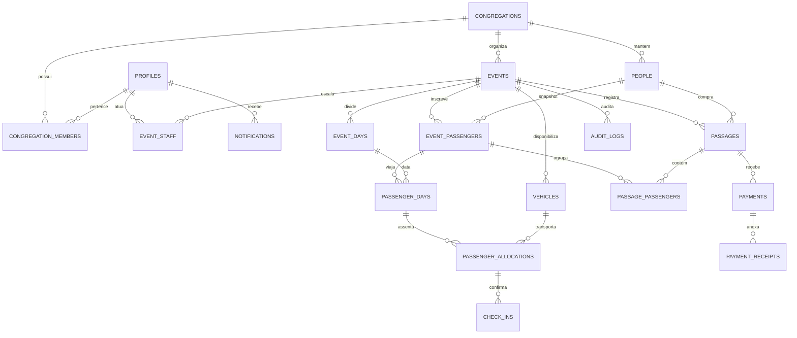

# Modelo de Dados e Banco de Dados (docs/database.md)

Este documento descreve o modelo relacional de banco de dados do sistema, implementado em PostgreSQL através do Supabase.

---

## 1. Diagrama Entidade-Relacionamento (Mermaid)

---

## 2. Detalhamento das Entidades Principais

### `congregations` & `congregation_members`
Isola os dados entre congregações. Toda tabela transacional é associada direta ou indiretamente a uma congregação, respeitada pelas regras de RLS.

### `people` (Cadastro Mestre)
Mantém o cadastro centralizado de publicadores e participantes na congregação. Possui suporte a `normalized_name` para buscas rápidas sem diferenciação de acentos ou caracteres especiais.

### `event_passengers` (Preservação Histórica com Snapshot)
Ao inscrever uma pessoa em um evento, campos críticos (`full_name_snapshot`, `document_type_snapshot`, `document_number_snapshot`, `birth_date_snapshot`, `responsible_name_snapshot`) são copiados. Alterações cadastrais futuras na tabela `people` **nunca modificam eventos passados**.

### `passenger_days`
Cada passageiro indica individualmente em quais dias do evento viajará. O valor da passagem é calculado pela soma dos dias de todos os passageiros do grupo.

### `passages`, `payments` e `payment_receipts`
- Uma **passagem** agrupa um ou mais passageiros para efeito de pagamento.
- Todos os valores são gravados em **centavos inteiros** (`amount_cents`), proibindo arredondamentos de ponto flutuante.
- Fotos de comprovantes são armazenadas no bucket privado do Supabase Storage.

### `passenger_allocations` (Alocação Dinâmica por Dia)
A alocação é por **(evento + dia + veículo)**. Um passageiro pode viajar no Ônibus 01 na sexta-feira e no Ônibus 02 no domingo.
O campo `position` representa a posição ordinal na lista, **não um número de poltrona**.

### `check_ins`
O check-in é **diário e por trecho** (`OUTBOUND` para Ida e `RETURN` para Volta).
